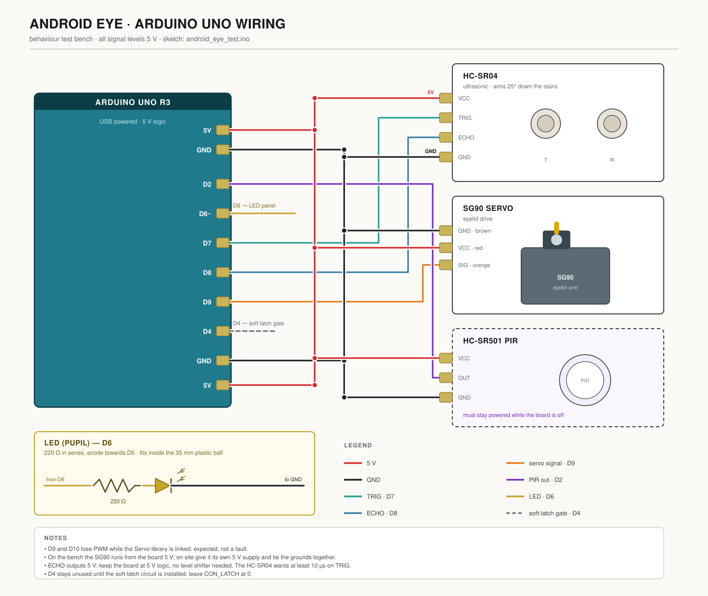
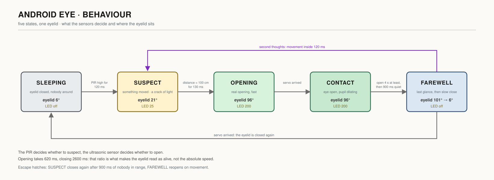
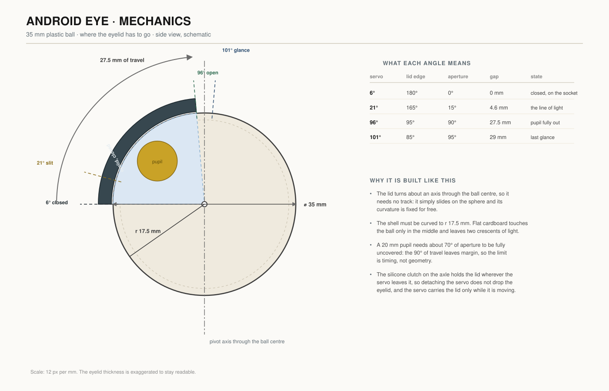

# android_eye_test

Behaviour test bench for a wall-mounted android face whose eyelid opens when
someone passes on the staircase.

This sketch covers **only the behaviour**: sensing, eyelid motion, pupil light.
Motor mechanics, sculpture and power supply are outside its scope.

## Hardware

| Qty | Part | Notes |
|-----|------|-------|
| 1 | Arduino Uno R3 | |
| 1 | HC-SR04 ultrasonic sensor | aimed ~25° downwards along the stair flight |
| 1 | SG90 micro servo | drives the eyelid |
| 1 | Plastic ball, **35 mm** diameter | ready-made sphere, serves as the eyeball |
| 1 | LED + 220 Ω resistor | sits inside the hollow eyeball (pupil) |
| 1 | PIR module HC-SR501 | optional for the bench, required on site |
| — | cardboard | temporary eyelid for the first run |

## Wiring

| Signal | Arduino pin |
|--------|-------------|
| HC-SR04 VCC / GND | 5V / GND |
| HC-SR04 Trig | **D7** |
| HC-SR04 Echo | **D8** |
| Servo signal (orange) | **D9** |
| Servo VCC / GND (red / brown) | 5V / GND |
| LED anode via 220 Ω | **D6** |
| PIR OUT | **D2** |

`D9` and `D10` lose PWM while the Servo library is linked — that is expected.



The same wiring, drawn module by module, is here and in `docs/wiring.svg`. Open
it in a browser: it is vector, so it stays readable at any zoom, and it is the
sheet to keep on the bench while you build.

Both diagrams come from `docs/generate.py`; change the numbers there and run
`python3 docs/generate.py`, rather than editing the SVG by hand.

## Running

1. Set `CON_PIR` to `0` for a bench test without a PIR, `1` when the PIR is wired.
2. Upload, open the serial monitor at **115200 baud**.
3. Send `v` to enable verbose output.

Commands: `v` verbose on/off · `o` force open · `c` force close · `d` read distance.

## States



```
SLEEPING  eyelid closed, nobody around
   | PIR triggers
SUSPECT   eyelid cracks open, a thin line of light appears
   | ultrasonic reads < D_NEAR
OPENING   real opening, fast
CONTACT   eye open, pupil dilating
   | nobody moving and nobody in range
FAREWELL  last glance, then slow close
   | movement detected -> back to SUSPECT
SLEEPING
```

The asymmetry is deliberate: opening takes 0.6 s, closing takes 2.6 s. That
ratio is what makes the movement read as alive rather than mechanical. Do not
equalise it.

## Tuning

Every tunable number is at the top of the sketch.

| Constant | Effect |
|----------|--------|
| `D_ANTICIPATE` | how far away the face starts to notice |
| `D_NEAR` | distance at which the eye opens fully |
| `T_SLIT` | how long the "hesitation" lasts — the most important value |
| `T_OPEN` / `T_CLOSE` | motion speeds; keep the 1:4 ratio |
| `T_MIN_OPEN` | minimum time the eye stays open, so it never closes on someone walking past |
| `LED_SLIT` | brightness of the line of light in the crack |
| `T_SERVO_RELEASE` | how quickly the servo is detached from power when idle (kills the buzz) |

## Mechanical notes

- The eyeball is an off-the-shelf plastic ball, **35 mm** across: radius
  17.5 mm. That radius sizes the whole mechanism, because the eyelid slides on
  the sphere and not on a flat plane.
- The sketch moves the eyelid from 6° to 96°, so 90° of arc: on a 17.5 mm
  radius that is **27.5 mm of travel** at the surface. That is the distance the
  servo horn has to cover, and the number to design the pivot around.
- The eyelid has to be **curved to the same 17.5 mm radius**. A flat piece of
  cardboard touches the ball only along its middle and leaves two crescents of
  light at the corners, which read as a badly fitted eyelid rather than as
  sleep.
- The eyelid needs a **friction clutch** on its pivot (a short piece of silicone
  tube over the axle). Without it, detaching the servo lets the eyelid fall.
- The inside of the eye socket must be **matte black**, otherwise the open eye
  reads as a hole rather than as depth.
- Two identical eyelids are needed: one moving, one glued shut on the other eye.



`docs/mechanics.svg` is the drawing to put on the bench next to the ball: where
the lid edge sits at each angle, how wide the gap is at each position, and the
27.5 mm of travel the horn has to cover.

## Power

`CON_LATCH` must stay `0` unless the soft-latch circuit is installed and the
board is not USB-powered, otherwise the board switches itself off after every
interaction.
